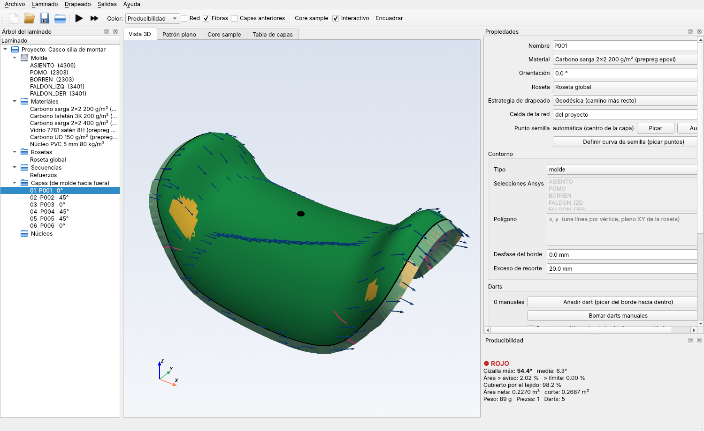
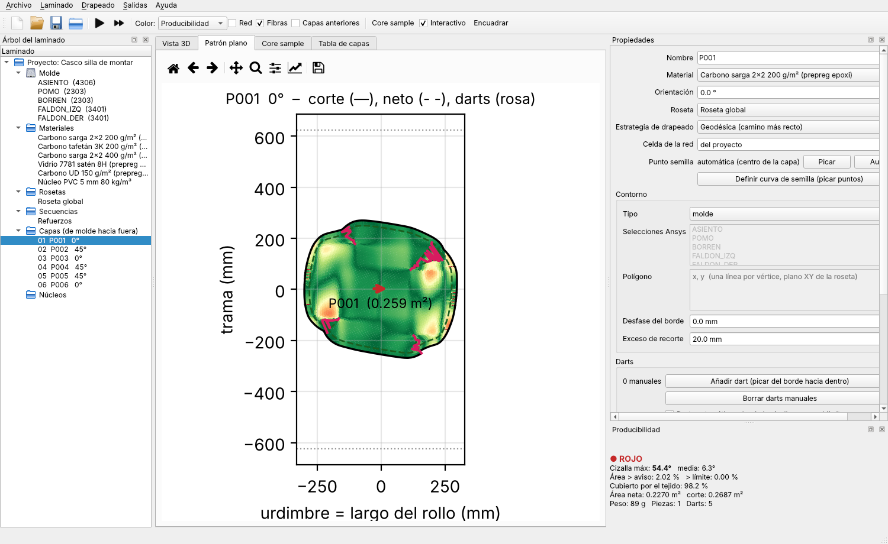

# Laminado Studio

Programa de escritorio para **diseñar y fabricar laminados de composite** sobre geometría de
**Ansys** (proyecto Workbench `.wbpz`, `ds.dat`, `.cdb`, `.rst`), STEP/IGES o STL. Reproduce el
flujo de trabajo de las herramientas profesionales de diseño de laminados: drapeado del tejido
sobre el molde, **producibilidad interactiva**, **estrategias de drapeado**, **darts y empalmes**,
patrones planos para la mesa de corte, anidado, proyección láser y **ply book**.

Caso de demostración: casco de silla de montar a caballo en tejido de carbono preimpregnado.




## Instalación (Windows)

**Opción A – ejecutable:** en GitHub, pestaña *Actions* → última ejecución correcta →
artefacto **LaminadoStudio-windows** → descomprimir y abrir `LaminadoStudio.exe`.

**Opción B – con Python** (3.11 o 3.12, marcando *Add python.exe to PATH*):

1. Descarga el repositorio (*Code → Download ZIP*) y descomprímelo.
2. Doble clic en `instalar.bat` (solo la primera vez).
3. Doble clic en `ejecutar.bat` (o `demo.bat` para abrir la silla de demostración).

En Linux/macOS: `pip install -r requirements.txt` y `python -m laminado`.

## Flujo de trabajo

1. **Archivo › Importar molde.** Abre el `.wbpz` de Workbench. Dentro del archivo se busca la
   malla en este orden: `ds.dat` → `.cdb` → `.rst` → STEP → STL. Las *Named Selections* de
   Mechanical aparecen bajo «Molde» y sirven como contornos de capa. Si el `.wbpz` no trae la
   malla escrita, en Mechanical haz clic derecho en *Solution* → *Write Input File* y vuelve a
   archivar, o importa directamente ese `ds.dat`. Las unidades se convierten a mm.
2. **Materiales:** espesor, peso, ancho de rollo, cizalla de aviso y límite (ángulo de
   bloqueo del tejido) y constantes elásticas. Ajústalos con la ficha técnica de tu preimpregnado.
3. **Rosetas:** dirección de 0° y normal (sentido positivo de giro).
4. **Capas** (de la cara del molde hacia fuera), con estos parámetros:
   - material y orientación;
   - contorno: todo el molde, una selección de Ansys o un polígono;
   - desfase del borde y exceso de recorte;
   - estrategia de drapeado, punto semilla y tamaño de celda.

   **Laminado › Asistente** crea varias capas a partir de una lista de orientaciones, con
   escalonado de caídas de capa (*ply drops*).
5. **F5** simula la capa. Con **Interactivo** activado, cada cambio de orientación, semilla,
   estrategia o contorno vuelve a drapear y repinta el mapa:
   - 🟢 cizalla por debajo del aviso;
   - 🟡 entre el aviso y el límite;
   - 🔴 por encima del límite o zona que el tejido no alcanza.
6. **Darts:** pulsa «Añadir dart» y haz clic derecho desde el borde hacia dentro; Intro para
   terminar. También puedes activar «Darts automáticos», que colocan darts donde la cizalla supera
   el límite.
7. **Empalmes:** se crean automáticamente por ancho de rollo (siguiendo una línea de trama, con
   solape, a tope o con hueco) o a mano en un punto, con el corte perpendicular a la urdimbre.
8. **Core sample:** clic derecho sobre el molde para ver las capas en ese punto, el ángulo real
   de fibra frente al nominal, la cizalla y las propiedades CLT con los ángulos reales.
9. **Salidas › Todas las salidas:**
   - DXF por pieza, con capas CORTE, NETO, FIBRA, TEXTO y DARTS;
   - anidado en rollo, respetando la dirección de la urdimbre;
   - proyección láser: contornos netos en 3D, en DXF y CSV;
   - ply book en PDF;
   - Excel con capas, consumo de material y anidado;
   - tablas de direcciones de fibra por elemento para Ansys ACP.

## Estrategias de drapeado

| Estrategia | Cómo se generan los hilos desde la semilla |
|---|---|
| Geodésica | Urdimbre y trama siguen el camino más recto sobre la superficie. |
| Plano natural | Los hilos generadores son la intersección del molde con el plano que contiene la semilla, la normal y la dirección. |
| Dirección fija proyectada | Los hilos generadores siguen la proyección de la dirección de la capa. |
| Curva de semilla | La urdimbre sigue una curva picada sobre el molde. |
| Mínima energía | Hilos inextensibles con la mínima cizalla total (Levenberg–Marquardt con jacobiano analítico). Admite tejido y unidireccional. |

Las cuatro primeras usan la red cinemática (*fishnet*): nodos a distancia h de sus vecinos sobre
la superficie, resueltos por barridos vectorizados con Newton en el plano tangente. Con darts, la
malla se abre por el corte y se relaja por energía para que el dart alivie la cizalla.

## Precisión verificada (`pytest`)

- **Cilindro:** cizalla < 1,5° (teórica 0°) y área plana igual al área de la superficie
  (error < 0,5 %).
- **Distancias geodésicas** (desfases y escalonados): exactas para bordes rectos (error < 1e-9 mm).
- **Mínima energía:** el jacobiano analítico coincide con diferencias finitas.
- **Darts:** reducen la cizalla máxima del casquete esférico.
- **Lector:** la ida y vuelta MAPDL/`.wbpz` conserva nodos, elementos y selecciones.
- **CLT:** el laminado cuasi-isótropo da Ex = Ey y B = 0.

## Estructura

```
laminado/
  geom/       malla, punto más cercano, geodésicas (fast marching), cortes, darts, superficie extendida
  ansys/      lector .wbpz / ds.dat / .cdb / .rst / STEP / STL
  drapeado/   red cinemática, estrategias, mínima energía, darts, empalmes, resultado y patrón plano
  modelo/     materiales, rosetas, contornos, capas, secuencias, núcleos, CLT, proyecto (.lam)
  salidas/    DXF, anidado, láser, ply book PDF, Excel, Ansys
  gui/        ventana principal (Qt + VTK)
  demo/       casco de silla paramétrico
tests/
```
